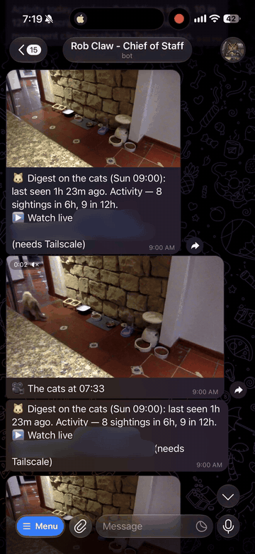

<div align="center">

# Ojo de Gato

**A private pet camera for your Mac that only speaks up when it has actually seen your pet.**

Your Mac's built-in image recognition checks every bit of motion, on the device, before anything reaches your phone.<br>
Ask your AI agent *"how are the cats?"* and get a live photo, real sightings and a video recap of the day.

[](LICENSE)


[Quickstart](#quickstart) · [Use it with your agent](#use-it-with-your-agent) · [What it watches](#what-it-watches) · [How it works](#how-it-works) · [Docs](#docs)

<!-- DEMO GIF: replace this comment with

-->

</div>

*Ojo de Gato* means "cat's eye" in Spanish. I built it to keep an eye on my cats while I travel.

## Why it exists

Basic motion detection on a webcam is close to useless. The camera keeps adjusting its own exposure and white balance, and every adjustment looks like movement. On the reference camera, over one day:

> **1,655 "motion" frames. Only 24 visits that actually had a cat, dog or person in them.**

Before recognition was added, the report said "243 motion moments in the last 6h" about a room that had been empty since morning, and the "last movement" clip showed an empty corridor. Changing thresholds can't fix that, because the camera really is changing a lot of pixels. What fixes it is having something look at the frames, and every Mac already ships with something that can.

## Features

- **Verified sightings, not motion noise.** Apple's Vision framework, running on your Mac, decides whether a cat, dog or person was really there. No model download, no API key, no account, no cloud.
- **Ask and see.** "How are the cats?" returns a live photo, "last seen 4 min ago, 6 sightings in 6h", a link to the live view, and a ~9-second clip of the last real sighting.
- **A daily recap video.** Up to 8 of the day's best moments, time-labelled and joined into one short video.
- **Twice-daily digests** at 9am and 9pm (the evening one includes the recap), with or without an agent.
- **Works with any agent.** OpenClaw skill, Hermes skill, and a built-in [MCP server](docs/mcp-server.md) for Claude Code, Codex or any MCP client, including an agent on a VPS reaching the camera at home over Tailscale.
- **The lid is the on/off switch.** Close the MacBook when you're home: recording, alerts and your agent's digests stop. Open it when you leave: everything resumes.
- **A watchdog that runs separately from everything else.** Plain launchd plus `curl`. If the stream dies, recording stalls, the disk fills or the room goes quiet for too long, it messages you directly.
- **Live view from your phone** over WebRTC or HLS, reachable only on your Tailscale network.
- **Rolling recordings** in 10-minute segments (48 hours or 9 GB by default), so you can answer "what happened around 3pm?".
- **Light-aware.** Day and night settings follow how bright the room actually is. In the dark, reports say "lights are off" instead of counting sensor noise.

## Quickstart

```sh
git clone https://github.com/garavitgabriel/ojogato.git
cd ojogato
./install.sh
ojogato setup
```

`install.sh` downloads ffmpeg and mediamtx for your architecture, builds and signs the camera app bundle and the on-device recognition helper (`ojogato-vision`), and installs the launchd services. `ojogato setup` walks you through allowing camera access once, connecting your Telegram bot, and detecting your Tailscale URL. To change what it watches, see [What it watches](#what-it-watches).

Then run `ojogato report` to get your first snapshot on Telegram.

**Requirements**

- A Mac with a camera, built-in or USB, on macOS 12 or later (Apple silicon or Intel).
- A Telegram account. The setup wizard connects the bot.
- [Tailscale](https://tailscale.com), recommended: it's how your phone reaches the live view and how a remote agent reaches the camera.
- An AI agent is optional.

**Everyday commands:** `ojogato status` · `ojogato report` · `ojogato recap` · `ojogato off` / `ojogato on` · `ojogato doctor`

## Use it with your agent

The monitoring never depends on an AI model. Agents only change how you talk to it. Whatever you use, the rule is the same: **the agent words the answer, but the facts come from the recognition pipeline.** It never claims to see something the recognition didn't confirm.

| You use | Set it up with | What you get |
|---|---|---|
| **No agent** | Nothing extra | Watchdog alerts and the 9am/9pm digests on Telegram. `ojogato report` / `ojogato recap` on demand. |
| **[OpenClaw](https://openclaw.ai)** | `openclaw/register.sh` installs the [`ojo-gato` skill](openclaw/skill/SKILL.md) and, optionally, the digest jobs | Ask in chat; the agent runs the report scripts and answers in its own voice. → [OpenClaw integration](docs/openclaw-integration.md) |
| **[Hermes](https://github.com/NousResearch/hermes-agent)** | `hermes mcp add` + the drop-in [`ojogato-cats` skill](examples/hermes/ojogato-cats/SKILL.md) | Ask in chat; photos and videos arrive in the agent's own chat. The skill also runs the 9am/9pm digests, which go quiet when the lid is closed. |
| **Claude Code, Codex, any MCP client** | One line of MCP config | The six read-only tools below, local or over Tailscale. → [MCP server](docs/mcp-server.md) |

**The MCP tools** (all read-only, so no agent can ever switch your monitoring off):

| Tool | Returns |
|---|---|
| `camera_status` | Paused or running, recognition health, light level, what's being watched |
| `list_events` | Verified sightings with times and confidence |
| `get_snapshot` | A live photo the agent can look at |
| `get_event_frame` | The best frame of a sighting |
| `get_last_clip` | The latest real sighting as a short video |
| `get_recap` | The day's recap video |

Videos come back as a private tailnet link or, for agents that can attach files (Hermes does), as the video itself. An agent running on a VPS reaches a camera at home over Tailscale; nothing is exposed to the internet.

## What it watches

I built it for my cats, but it watches whatever matters to you, as long as Apple Vision can recognise it: **cats, dogs and people.**

```sh
# ~/.ojogato/config.env (read fresh by every report)
OJOGATO_SUBJECT="the dog"           # how messages and your agent refer to it
OJOGATO_PET_NAMES="Luna, Toby"      # optional, used as a group
```

| Point it at | Set `OJOGATO_SUBJECT` to | It reports |
|---|---|---|
| Your cats or dog while you're away | `"the cats"`, `"the dog"` | When they were last seen, how active they were, the day's best moments |
| Your front door or entryway | `"the front door"` | When someone came and went, with a clip of each visit |
| An empty home while you travel | `"the house"` | Silence on a normal day, a clip when a person shows up |

Recognition can't tell cat from dog reliably at webcam resolution, or one animal from another, so animals are reported as one "pet" class and pet names refer to the group. Something it can't recognise (plants, a 3D printer) would only produce unverified motion, so that isn't a supported use yet. Please only point the camera at your own space.

## How it works

Motion detection only suggests that something might have happened. **Apple's Vision framework, running on your Mac, decides whether it did.**

- **Everything stays on the Mac.** `VNRecognizeAnimalsRequest` and `VNDetectHumanRectanglesRequest` ship with macOS. A camera pointed at your living room doesn't need the internet to tell a cat from a lighting change.
- **It answers one closed question:** cat, dog, person or nothing, with a confidence score you can check. It never describes a scene and never makes things up.
- **It decides per visit, not per frame.** A cat with its back turned gets missed in individual frames, but a cat that's really in the room shows up across many of them, and recognising it in one is enough. Exposure flicker never gets recognised in any. Over a full day of validation: 24 real events, zero false positives in a window checked by hand as empty.
- **It still sees subjects far away.** The frame is split into overlapping tiles so a cat at the end of a hallway still gets detected. On the reference camera that raised detected animal frames from 199 to 349 a day, with no new false positives.
- **It tells you when it's off.** If recognition is disabled or stops working, reports label the counts as unverified instead of passing camera noise off as cats.

Every count, "last seen" time, clip and recap is built from these verified events, so they can't disagree with each other.

<details>
<summary><b>Architecture</b></summary>

```
  camera (avfoundation, resolved by name)
          |
   capture-stream.sh          ffmpeg, hardware h264, ~0.22 GB/h
          |
          v
       mediamtx  ------ RTSP, loopback-only 127.0.0.1:8554
      /    |    \
     v     v     v
  live   recorder   motion detector
  view   record.sh  motion-run.sh
  WebRTC 10-min     ffmpeg deflicker + mpdecimate
  :8889  fragmented   -> CANDIDATE frames
  HLS    mp4           ("pixels changed")
  :8888  segments          |
 (tailnet   |              v
   only)    |    vision-run.sh / ojogato-vision
            |    Apple Vision, on-device, tiled
            |    cat / dog / person / nothing?
            |              |
            |              v
            |         events.sh   candidates -> EVENTS
            |                     real iff a subject was
            |              |      seen in >= 1 frame
            +------+-------+
                   |
                   v
     report.sh / clip.sh / recap.sh
     snapshot + sightings + clip + day recap
                   |
                   v
       Telegram  (directly, or via your agent)

  MCP server (ojogato_mcp.py, :8790, tailnet-only, read-only tools):
  the same facts, photos and videos for any MCP agent, local or on a VPS.
  lid-watch.sh: lid closed -> paused, lid open -> resumed.

  heartbeat.sh: deliberately OUTSIDE everything above.
  Plain launchd + curl. It alerts you when the stack breaks
  or the room goes too quiet.
```

Recordings use **fragmented mp4**, which lets `clip.sh` and `recap.sh` cut footage from the segment that's still being written, without waiting for the file to close.

</details>

### Design philosophy: reliable core, AI optional

Everything that matters is plain ffmpeg, shell and Apple's on-device classifier, and none of it can make things up. Motion detection is cheap and allowed to be wrong; recognition is a classifier with a confidence score, not a narrator; stats count verified events whose frames stay on disk; the "last movement" evidence is a real clip, never a guessed still; and the watchdog fires whether or not any agent is running. The LLM only adds voice, and it's optional.

## Honest limitations

- **No night vision** on built-in Mac cameras. Leave a light on, or use a USB camera with IR.
- **The lid must stay open** to use a MacBook's built-in camera, which is why the lid is the switch. Using a USB camera with the lid closed? Set `OJOGATO_LID_SWITCH="0"`.
- **macOS only for now.** Linux support (an RTSP camera with systemd) is on the [roadmap](docs/roadmap.md).
- **Recognition is good, not perfect.** Something that crosses the frame in under a second, in the dark, can be missed.
- **One camera per Mac** today. Multi-camera is on the roadmap.

## Docs

- [MCP server](docs/mcp-server.md): tools, connecting Claude Code / Hermes, scheduled digests, the cron-poll recipe, security.
- [Hermes skill](examples/hermes/ojogato-cats/SKILL.md): drop-in skill so a Hermes agent answers questions and sends the digests.
- [OpenClaw integration](docs/openclaw-integration.md): what `register.sh` sets up and what using it with the agent is like.
- [Privacy and networking](docs/privacy-and-networking.md): Tailscale first, no cloud, no accounts.
- [Motion tuning](docs/motion-tuning.md): the phantom-motion story, the settings you can adjust, and how to validate them.
- [Why headless camera access fails on macOS (and the fix)](docs/tcc-camera-permission.md): a deep dive on macOS camera permissions (TCC).
- [Roadmap](docs/roadmap.md): Linux/VPS, multiple cameras, masking zones.
- [Changelog](CHANGELOG.md)

## License

[MIT](LICENSE) © Gabriel Garavit
